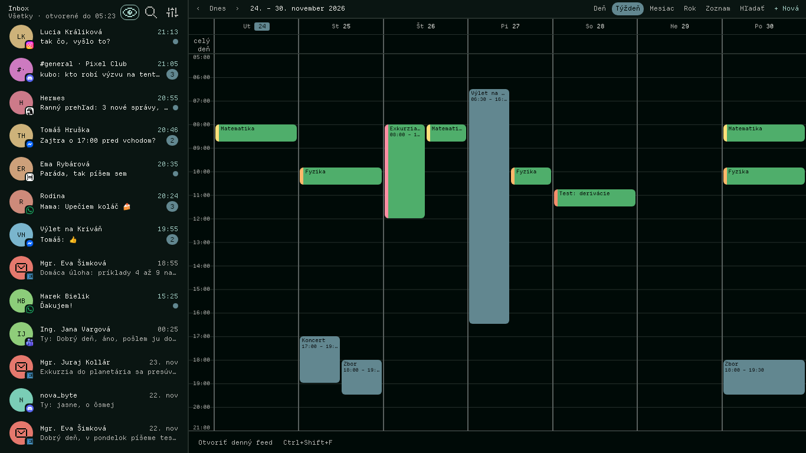
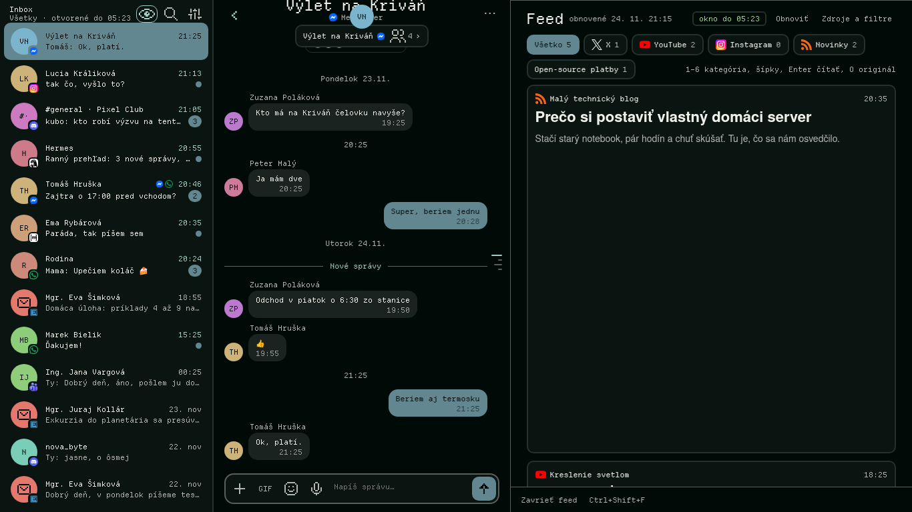

# Weft

Weft is a self-hosted Beeper of one's own: every chat and mail (EduPage, Messenger, Instagram, WhatsApp, Discord,
Teams, Outlook, Gmail and Matrix) in one keyboard-first inbox next to a calendar, shown only when you choose to read.



## Try it in a minute

You need only Git, Python 3 and a browser. Nothing leaves your machine and every person in it is made up:

```sh
git clone https://github.com/Gooder24/weft && cd weft && tools/demo
```

Open the address it prints (http://127.0.0.1:8790/demo). `tools/demo` serves the real client from `app/` next to
a pretend homeserver, bridges, calendar and Feed in one process on 127.0.0.1; what you send stays in its memory and
the people answer with canned lines. Try Ctrl+K (search), Ctrl+N (a new chat), Ctrl+Shift+F (Feed) and Ctrl+,
(Settings).

## What is different

- **Reading windows.** Messages wait until you open a reading window (1 to 8 a day, 5 to 30 minutes each, set by
  you); people you mark as work always come through. The daily Feed (RSS, YouTube, X, Instagram) shares the windows.
- **Merged chats.** One person's chats on Messenger, Instagram, WhatsApp and Discord become one row and one
  history; clear cases merge by themselves, the rest when you say so, and a pair you split never merges again.
- **Own bridges** next to the mautrix ones: EduPage (messages, notices, homework, grades and tests in the
  calendar), Teams, Outlook, Gmail (with one-time codes in a small window) and Matrix (an account on matrix.org or
  beeper.com with its own encrypted device).
- **`weft` for agents.** A command-line client (`server/cli/weft.py`) reads, searches, drafts and sends, so an AI
  agent can work with the same inbox under its own device.
- **Import from Beeper.** `server/archive/import_beeper.py` reads a copy of Beeper Desktop's data folder into
  Weft's archive, without duplicates.
- **A calendar beside the chats**, with repeats, reminders and .ics import and export, the school timetable mirrored
  in, and "Add to calendar" under a message that names a time.



## Networks

| Network | How | State |
|---|---|---|
| Messenger, Instagram | mautrix-meta, with small patches in `server/bridges/` | daily use |
| WhatsApp | mautrix-whatsapp, patched for profiles and statuses | daily use |
| Discord | mautrix-discord (legacy), patched for polls and profiles | daily use |
| EduPage | own bridge, `server/edupage/` | daily use |
| Teams | own bridge through Microsoft Graph, `server/microsoft/` | daily use |
| Outlook | own bridge through Microsoft Graph, `server/microsoft/` | daily use |
| Gmail | own bridge over IMAP and SMTP, `server/gmail/` | beta |
| Matrix | own bridge with end-to-end encryption, `server/matrix/` | beta |

## How it is built and checked

Weft is written with AI agents (Claude Code and others), steered and used every day by its one owner. An agent's
own "done" does not count: changes are checked by tests that drive the real client in headless Chromium against
fakes, or against real data with every write intercepted, and then by two independent verifier agents (different
models) that get only the goal and the change and report what they could break. Nothing is ever sent to real
people while testing.

The client in `app/` is plain JavaScript with no build step; `desktop/` is the Electron shell; `server/` holds the
bridges and services that run on the owner's host (a Tuwunel homeserver, systemd user units, Caddy). There is no
installer for the server side yet: `CLAUDE.md` describes how the owner's host is laid out.

## Requirements

- To try it: Python 3 (`tools/demo` uses only its standard library).
- To run the checks: Node.js 22.12 or newer, npm, and Chrome or Chromium. If it is not in `/usr/bin/chromium`,
  `/usr/bin/chromium-browser`, `/usr/bin/google-chrome` or `/usr/bin/google-chrome-stable`, set `CHROME_PATH`.
- The Matrix bridge test needs a Tuwunel binary and python3-olm (see `tests/matrix/run.py`).

## Tests

Install the test dependencies and run the accessibility checks:

```sh
npm ci --prefix tests/accessibility && npm test --prefix tests/accessibility
```

- `npm test --prefix tests/accessibility` runs axe-core on the sign-in screens and a keyboard-only smoke test, in
  headless Chromium. Requests that do not go to the local server are blocked.
- `python3 .github/scripts/check-docs.py` checks the Markdown files for heading order, image alt text and link text.
- `node tests/demo/demo.cjs` starts `tools/demo` and checks the inbox, a chat, search, Settings, Ctrl+N and Feed,
  and that no request leaves 127.0.0.1.
- `.github/workflows/accessibility.yml` runs these on every pull request.
- `python3 tests/matrix/run.py` checks the Matrix bridge against two throwaway homeservers.

Known problems are recorded in `.github/a11y-baseline.json`, `tests/accessibility/axe-baseline.json` and the `KNOWN`
list in `tests/accessibility/keyboard.cjs`. A new problem fails the checks.

## Accessibility

See [ACCESSIBILITY.md](ACCESSIBILITY.md) for the goals, what is tested, what is not, and how to report a barrier.

## License

Copyright (C) 2026 Gooder24

Weft is free software: you can redistribute it and/or modify it under the terms of the GNU Affero General Public
License, version 3 or (at your option) any later version (`AGPL-3.0-or-later`), see [LICENSE](LICENSE). Among other
things, the AGPL asks that if you change Weft and let people use it over a network, you offer all of them the source
code of your version.

Parts by others keep their own licenses:

- In `app/`: [pixelarticons](app/pixelarticons-LICENSE) (MIT), qrcode-generator in `app/qrcode.js`
  ([MIT](app/qrcode-LICENSE)), the Kalendarix colour rules in `app/kalendarix-colors.js`
  ([MIT](app/kalendarix-LICENSE)), Departure Mono ([SIL Open Font License 1.1](app/fonts/DepartureMono-LICENSE)) and
  `app/emoji.json`, built from Unicode CLDR and Unicode emoji data ([Unicode License v3](app/emoji-LICENSE)).
- The service logos in `app/` (`*.png`, `*.ico`, `*.webp`, the Matrix mark in `matrix.svg` and the Hermes Agent icon in `hermes.svg`) are trademarks
  of their owners and are not covered by this license.
- The patches in `server/archive/` and `server/bridges/` change the mautrix bridges and stay under their AGPL-3.0.
- `server/edupage/bridge.py` uses [edupage-api](https://pypi.org/project/edupage-api/) (GPL-3.0-or-later), which
  the AGPL allows to combine with it.
