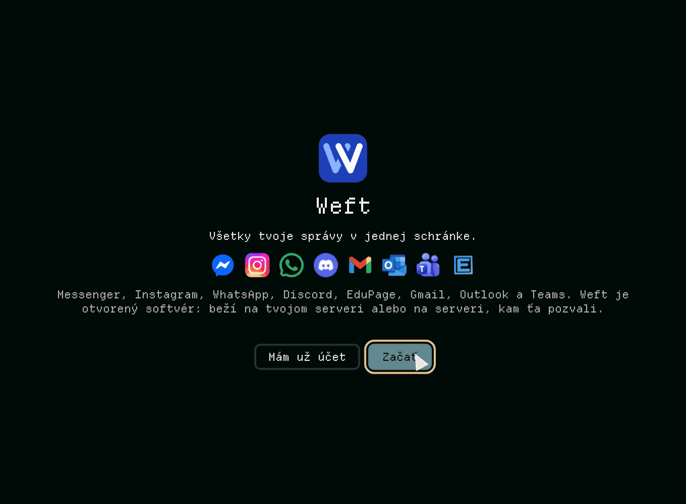
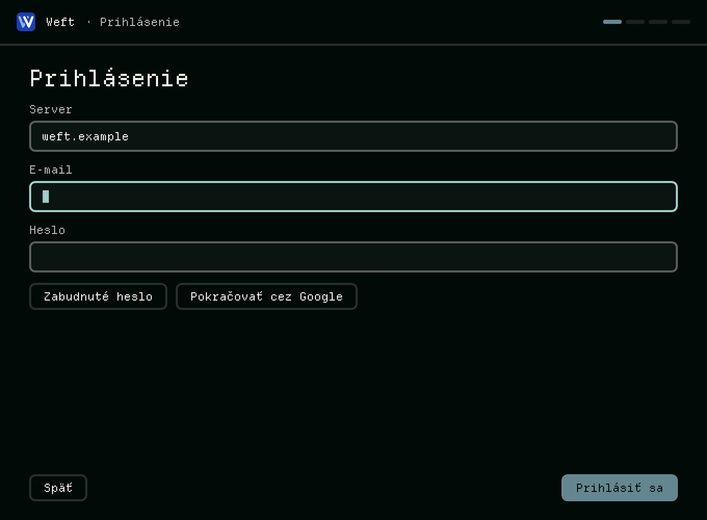
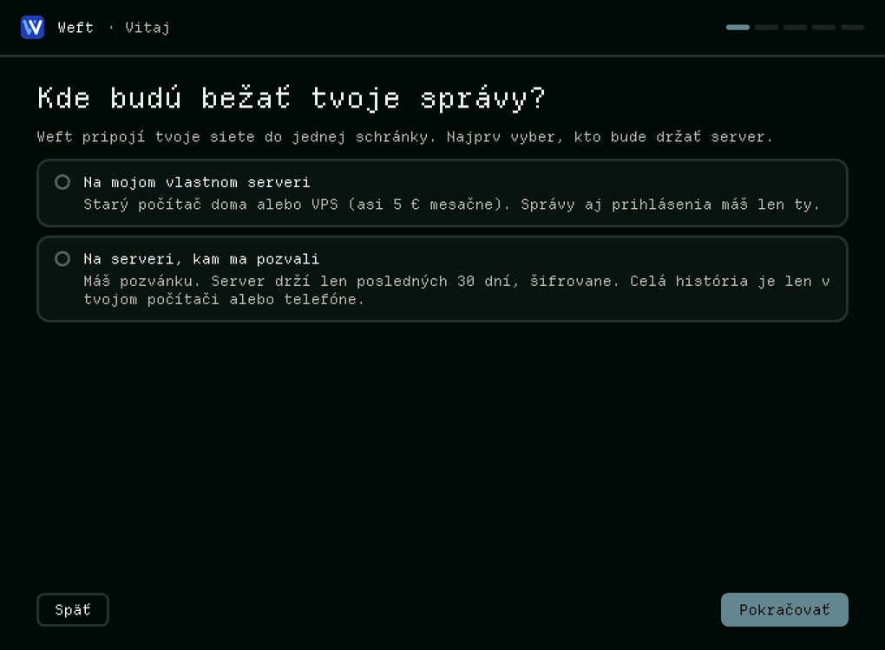
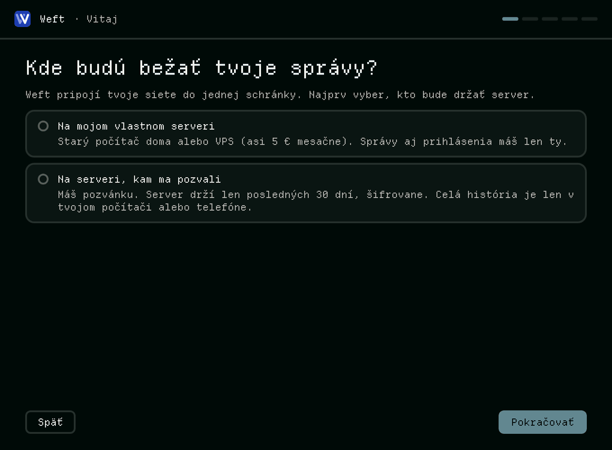
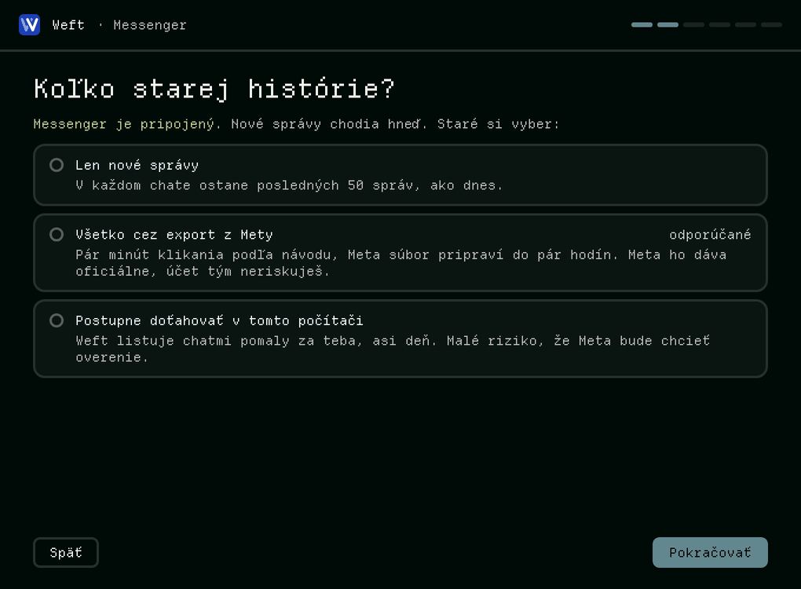
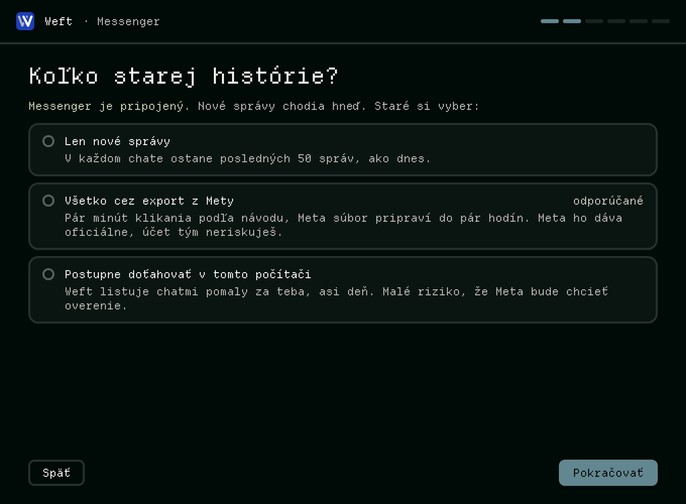
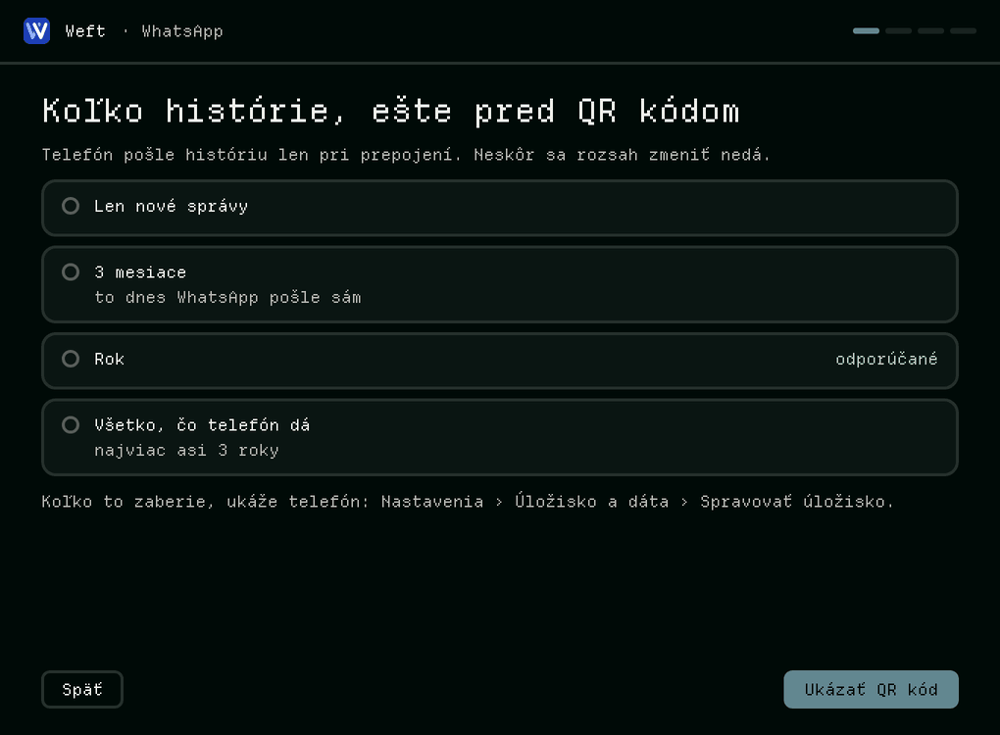
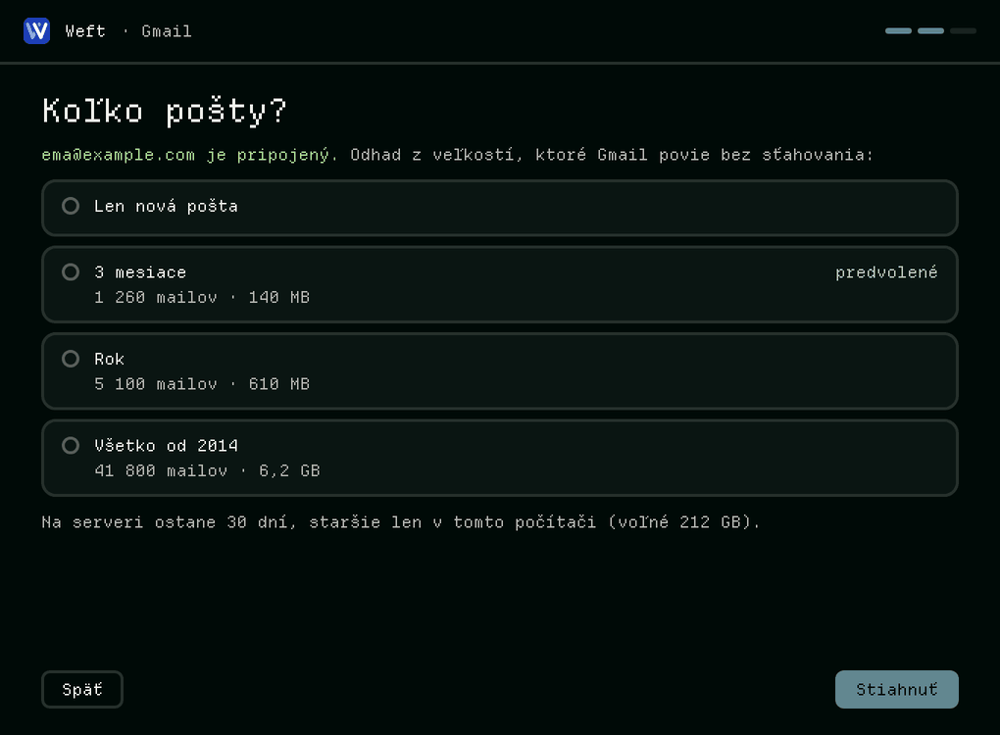

# Plán: prvé spustenie, história a kde bude uložená

Nadväzuje na [rozbor](README.md). Napísal ho agent 25. 11. 2026 podľa Karchiho zadania. Rieši tri veci: ako človek bez
Beeperu dostane do Weftu starú históriu, ako ho Weft prevedie vlastným serverom alebo pozvánkou na cudzí server a ako
cudzí server drží čo najmenej. Postavené z toho je len odhad miesta (`server/archive/estimate.py`) a klikacie ukážky
v [ukazky/](ukazky/). Ostatné je plán.

## Odpovede krátko

1. **Doťahovanie v pozadí počas dňa: áno, ale nie ako rozšírenie prehliadača.** Spraví to desktopová appka cez most,
   ktorý už beží (patch `messenger-archivefetch` / `instagram-archivefetch`, strana má 50 správ). Pri tempe jedna strana
   za minútu je to 3 000 správ za hodinu, takže 38 000 správ trvá asi 13 hodín zapnutého počítača, teda asi deň.
   Rozšírenie prehliadača by bol druhý klient Mety vedľa mostu, často z inej IP. Šifrované chaty na webe Messengera
   bez PIN nevidí. Meta web často mení a rozšírenie by muselo čítať cookies. Ani doťahovanie cez most nie je
   bez rizika, preto nie je predvolené a zastaví sa pri prvom overení od Mety.
2. **Efektívnejšia metóda je export z Mety.** Meta ho dáva oficiálne a naraz: „Stiahnuť tvoje informácie“ v Accounts
   Center pre bežné chaty a „Stiahnuť dáta z bezpečného úložiska“ na messenger.com pre šifrované. Pri Instagrame platí to
   isté. Účet tým človek neriskuje, preto je to v sprievodcovi predvolené. Import týchto súborov už existuje
   (`import_messenger.py`, `archive.py instagram`) a odhad tiež (`estimate.py messenger|instagram`).
3. **ChatGPT, ktorý spraví export za človeka: neodporúčam.** Agent sa do Mety prihlási z cloudu OpenAI a Meta skôr
   pýta overenie práve pri prihlásení z dátového centra. Prihlásenie mu navyše ostane v cloudovom prehliadači a
   samotné cookie stačí na vstup do účtu bez hesla aj druhého faktora. Hotový export (často 1 až 5 GB) by skončil v
   cloudovom prehliadači, nie v počítači človeka. A potreboval by predplatné. Návod so šiestimi krokmi trvá tri minúty
   klikania a Weft po ňom súbor skontroluje.
4. **„Je to bezpečné, ak začiarkneš len Správy“:** sprievodca to povie a overí. Po pustení súboru Weft vypíše, čo v ňom
   je. Ak tam je aj niečo iné (príspevky, poloha), povie to a prečíta len priečinok so správami. Súbor sa číta v
   počítači a na server neodchádza. Po importe Weft ponúkne ZIP zmazať, lebo obsahuje všetky správy.
5. **Vlastný server:** sprievodca vypíše, čo treba (počítač, ktorý stále beží, 15 minút, Tailscale), dá príkazy,
   inštalátor nájde sám a potom ponúkne históriu sieť po sieti s odhadom miesta. Je to inštalátor z PR #4, ktorý ešte nie
   je napísaný.
6. **Pozvánka na tvoj asus:** na serveri sú len prihlásenia do sietí a posledných 30 dní, šifrované tak, že ich server
   bez kľúča zo zariadení neotvorí. Staršia história je len v počítači alebo telefóne. Jeden háčik ostáva: správa
   prechádza mostom na serveri a most ju musí prečítať, aby ju preložil do Matrixu. Kto server prevádzkuje, ju teda
   technicky vidí vo chvíli, keď prechádza. Sprievodca to povie jednou vetou (obrazovka „Čo bude na serveri a čo nie“).
   Disk asusu dnes šifrovaný nie je (btrfs bez LUKS), takže pri krádeži stroja chráni len šifrovanie Matrixu.

## Ako to vyzerá

Ukážky sú nakreslené Weftovými farbami a písmom, s vymyslenými ľuďmi a číslami. Klikacia verzia všetkých ciest je
[ukazky/onboarding.html](ukazky/onboarding.html) (šípky listujú). GIFy z nej robí `ukazky/record.cjs`.

### Privítanie a účet Weftu

Prvá obrazovka povie, čo Weft je, a ponúkne „Začať“ alebo „Mám už účet“. Účet Weftu je e-mail a heslo, alebo
„Pokračovať cez Google“. Po vytvorení príde na e-mail odkaz na overenie a stránka po kliknutí pokračuje sama.
Prihlásenie na ďalšom zariadení je e-mail a heslo. Pri šifrovanom účte potom zariadenie dostane kľúče: potvrdením
v inom zariadení (obe ukážu rovnakých sedem slov) alebo kľúčom na obnovenie. Zabudnuté heslo pošle odkaz na e-mail.

### 1. Vlastný server

Kde budú bežať správy → čo treba → príkazy (stránka čaká, kým server odpovie) → účet s e-mailom → overenie e-mailu → siete, žiadna povinná →
„Kde má byť história?“ (na serveri, alebo aj v počítači).

### 2. Pozvánka na cudzí server (asus)

Kód pozvánky → účet s e-mailom → overenie e-mailu → čo bude na serveri a čo nie → kľúč na obnovenie → kde bude celá história (počítač, telefón, nikde) →
siete.

### 3. Messenger alebo Instagram: export z Mety (odporúčané)

Koľko histórie → šesť krokov návodu (stránka Mety, len Správy, JSON a celé obdobie, šifrované chaty zvlášť, čakanie
s pripomienkou, pustenie súborov) → kontrola obsahu a miesta → import v pozadí → ponuka zmazať ZIP.

### 4. Messenger alebo Instagram: postupne doťahovať

Rozsah s odhadom času → riadok v Nastaveniach → Účty s percentami, Pozastaviť a Zastaviť → keď Meta chce overenie,
všetko stojí a nič sa neskúša znova.

### 5. WhatsApp

Rozsah ešte pred QR kódom (potom sa zmeniť nedá) → QR → telefón posiela → hotovo, s radou, ako dostať celý jeden chat
(export chatu v telefóne).

### 6. Gmail (Outlook rovnako)

Koľko pošty, s počtom a veľkosťou z IMAP-u bez sťahovania → priebeh, Pozastaviť → prehľad: na serveri 30 dní,
zvyšok v tomto počítači, „Pridať staršiu poštu“, „Zmazať z tohto počítača“.

## Technická stránka

Po častiach, v poradí, v akom na sebe stavajú. Každá časť má vlastné overenie (nižšie) a vlastný commit. Čas je práca
agenta s overením, bez čakania na rozhodnutia.

| # | Časť | Čo sa zmení | Závisí od | Čas |
|---|---|---|---|---|
| 0 | Účet Weftu s e-mailom | Tuwunel 1.9.4 to vie sám: `[global.smtp]` posiela overovací mail, `require_email_for_token_registration` chce overený e-mail aj pri registrácii s pozvánkou (`registration_token`), `registration_terms` ukáže pred registráciou podmienky (obrazovka „Čo bude na serveri“), `identity_provider` prihlási cez Google (OIDC, treba vlastného Google klienta). Weft dnes prihlasuje menom a heslom (`m.login.password`, predvyplnené `karchi`). Pribudne registrácia v appke (kroky pozvánka, e-mail, podmienky), prihlásenie e-mailom, zabudnuté heslo a pri šifrovanom účte overenie nového zariadenia | nič, odosielanie mailov tvoje áno | 3 dni |
| 1 | Sprievodca a nepovinná EduPage | `app.js`: obrazovky z ukážok, siete ako dlaždice, EduPage s tlačidlom Pripojiť ako ostatné, odstrániť predvyplnené `karchi` a text „na x270“ | nič | 2 dni |
| 2 | Rozsah histórie a odhad v appke | `GET /_archive/estimate?net=…` volá `estimate.py`, Gmail a Outlook dostanú `since`, stav a pauzu v `accounts.json` (importér už ide po dávkach od najnovšieho), Teams ďalšie strany po hranicu, riadok „história: 34 %“ v Nastaveniach → Účty | 1 | 3 dni |
| 3 | WhatsApp pred QR | rozsah do `history_sync` pri prihlásení; dnes je `days_limit` jedno číslo pre celý most, preto treba overiť, či ho mautrix-whatsapp vezme pri každom prihlásení zvlášť, inak malý patch | 1, tvoje áno (mení konfiguráciu mostu) | 1 deň |
| 4 | História v počítači | desktopová appka si drží vlastný `archive.db` (rovnaká schéma ako na serveri, `node:sqlite` v Electrone) a médiá. Weft z neho číta staré správy, vyhľadávanie, galériu a štatistiky, keď ich server nemá. Ten istý kód číta ZIP od Mety v počítači (preklad `import_messenger.py` a `archive.py instagram` do JS appky) | 1 | 5 dní |
| 5 | Doťahovanie cez deň | appka si pýta stranu za stranou (`archivefetch` už to vie) najviac raz za minútu, len kým je zapnutá a nie od 23:00 do 7:00, kurzor po chate a pokračuje, kde skončila. Pri overení, 429 alebo inej chybe Mety sa zastaví a čaká na človeka. Pri pozvánke strana ide do počítača a server si ju nenechá | 4, tvoje áno (mení tempo mostu a je to hromadné sťahovanie) | 3 dni |
| 6 | Pozvánky a 30 dní na serveri | kódy pozvánok (registrácia s tokenom v Tuwuneli), účet „hostovaný“: `archive.py mirror` ho preskočí, mailové importéry dávajú staršie ako 30 dní len do počítača, denné mazanie starších udalostí. Či to Tuwunel vie (purge histórie miestnosti), je neoverené; ak nie, nové miestnosti po 30 dňoch a staré opustiť. Limit ľudí a `MemoryMax` na každého | 4 | 5 dní |
| 7 | Šifrovanie | Weft sa naučí Matrix E2EE: `matrix-sdk-crypto-wasm` (vodozemac, to isté, čo používa Element), kľúč na obnovenie a záloha kľúčov na serveri len zašifrovaná. Mosty na Go (Meta, WhatsApp, Discord) majú `encryption.default/require`. Vlastné mosty v Pythone (EduPage, Gmail, Microsoft) by šifrovali cez libolm ako most Matrix, čo je zastarané (známe CVE), preto pri nich najprv len 30 dní na serveri bez šifrovania (staršia pošta len v počítači) a šifrovanie až s mostom na vodozemac. Obrazovka pozvánky to musí povedať pri pošte zvlášť. Serverové veci, ktoré čítajú text (vyhľadávanie, štatistiky, Feed, rozpoznávanie času, `weft` pre agentov), pri hostovanom účte prejdú do zariadenia alebo nebudú | 6 | 2 až 3 týždne |
| 8 | Inštalátor vlastného servera | `install.sh` z PR #4: homeserver, mosty, Caddy, Tailscale, automatické aktualizácie. Stránka sprievodcu ho nájde cez `/release.json` | nič, beží súbežne | 3 až 5 dní |
| 9 | Telefón | celá história v telefóne: appka v prehliadači má úložisko, ktoré prehliadač môže vyprázdniť, preto až s natívnou appkou alebo s kópiou z počítača | 4 | neskôr |

Exporty z Mety aj doťahovanie sú pre vlastný server rovnaké. Rozdiel je len v tom, kam zapisujú: na vlastnom serveri
do archívu servera, pri pozvánke do počítača.

## Ako overím, že je to dobre

Nič z toho sa neskúša na skutočných ľuďoch ani na Karchiho účtoch. Každá časť má test proti falošnému serveru a po
každej idú dvaja nezávislí overovatelia (`tools/verify-on-asus`).

- **Falošné zdroje:** generátor vymyslených exportov Mety (bežný aj šifrovaný formát, aj s priečinkami navyše:
  príspevky, poloha), falošný IMAP (už je v `tests/estimate`), falošný Graph (už je v `overenie/microsoft`), falošný
  `archivefetch` a provisioning WhatsAppu.
- **Kanárik na serveri (časti 4, 6, 7):** vymyslený chat s jedinečným reťazcom starším ako 30 dní prejde importom aj
  mazaním na skúšobnom Tuwuneli. Potom `rg -a` cez každý súbor servera (databáza Tuwunelu, databázy mostov, archív,
  logy, journal) nesmie reťazec nájsť. V `archive.db` počítača musí byť. Pri šifrovaní to isté s čerstvou správou:
  v databáze homeservera nesmie byť jej text. Druhé zariadenie bez kľúča ju neotvorí, kľúč na obnovenie áno.
- **Žiadny ban (časti 3, 5):** testovací server zlyhá na každú požiadavku na domény Mety alebo WhatsAppu mimo
  falošných. Tempo sa skúša s falošnými hodinami, bez čakania: simulovaných 24 hodín dá najviac jednu stranu za
  minútu, v noci nič a po prvom overení od Mety už ani jednu.
- **E-maily:** Tuwunel posiela na falošný SMTP server v teste, nie skutočným ľuďom. Test prejde registráciu s
  pozvánkou a overením, prihlásenie e-mailom a zabudnuté heslo na skúšobnom Tuwuneli. Neoverené je zatiaľ, či Tuwunel
  prihlási e-mailom (`m.id.thirdparty`), či posiela odkaz alebo kód a koľko pozvánok naraz vie.
- **Celá cesta v prehliadači:** každá ukážka sa zmení na test, ktorý ju prejde na novom prázdnom účte proti
  skúšobnému homeserveru. K tomu `tools/ui-check`, `tools/i18n-check` a `citacka` na sprievodcovi (čítačka obrazovky).
- **Odhad:** `estimate.py` už má 7 testov a na skutočných exportoch sedel do 20 %. Pred časťou 2 ešte jeden beh na
  skutočnom Gmaile (len hlavičky, `EXAMINE`), na tvoje áno.
- **Skutočná Meta len raz a s tvojím áno:** doťahovanie na jednom skúšobnom účte Mety, nie na tvojom, s počítaním,
  koľko strán prejde pred prvým overením.

## Čo s tým nesedí z predošlých rozhodnutí

- V [prevádzke](../2026-11-prevadzka/README.md#odporúčanie) je odporúčanie hostiť na asuse len domácnosti: pri
  známych mimo nej si prevádzkovateľ podľa GDPR a všetky ich účty Mety idú z jednej IP. Pozvánky (časť 6) to menia.
  Šifrovanie a 30 dní znižujú, čo by mohlo uniknúť, ale prevádzkovateľom ostávaš.
- [Rozbor](README.md#cloud-alebo-lokálne) odporúčal „len v počítači“ zatiaľ nerobiť. Pri pozvánke je to teraz
  pravidlo, pri vlastnom serveri ostáva voľba.

## Rozhodnutia pre teba

1. **Pozvánky na asus: komu a koľkým?** Navrhujem najviac 5 ľudí, pozvánka na jeden účet a sprievodca povie, kto
   server prevádzkuje.
2. **Doťahovanie cez deň (časť 5) vôbec stavať?** Mení tempo mostu a je to hromadné sťahovanie, takže bez tvojho áno
   nie. Odporúčam postaviť ho, ale nechať ho až za exportom. Skúšať ho len na skúšobnom účte Mety, ktorý by si založil
   ty.
3. **Šifrovanie (časť 7) teraz, alebo až keď pozvaných pribudne?** Je to najväčší kus (2 až 3 týždne) a vypne pri
   hostovaných účtoch serverové vyhľadávanie, Feed a `weft`. Odporúčam najprv časti 1 až 6 (30 dní a história len v
   počítači) a šifrovanie hneď za nimi, pred prvou pozvánkou mimo domácnosti.
4. **ChatGPT export vynechať?** Odporúčam áno, z dôvodov v bode 3 hore.
5. **Z akej adresy posiela asus overovacie maily?** Odporúčam novú adresu len pre Weft (napríklad nový Gmail s heslom
   aplikácie), nie tvoju. Je to prvá vec, ktorú Weft pošle cudzím ľuďom, preto bez tvojho áno nie.
6. **Prihlásenie cez Google aj pre Weft účet?** Odporúčam až neskôr: Google klient pre cudzích ľudí znamená overenie
   appky u Googlu. E-mail a heslo stačia.
