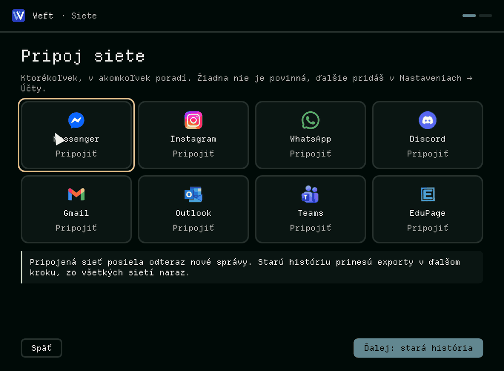
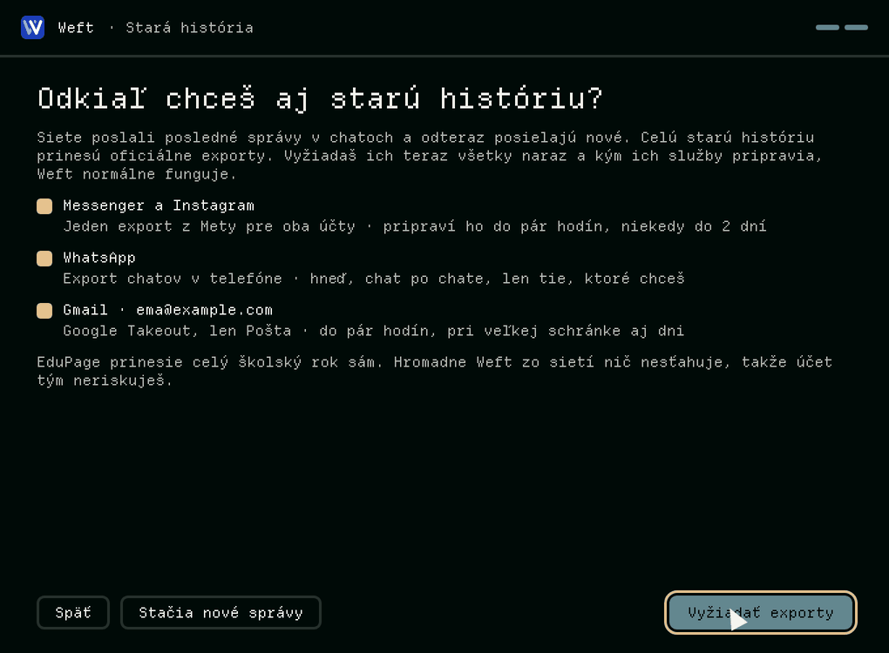

# Plán: prvé spustenie, história a kde bude uložená

Nadväzuje na [rozbor](README.md). Napísal ho agent 25. 11. 2026 podľa Karchiho zadania. Rieši tri veci: ako človek bez
Beeperu dostane do Weftu starú históriu, ako ho Weft prevedie vlastným serverom alebo pozvánkou na cudzí server a ako
cudzí server drží čo najmenej. Postavené z toho je len odhad miesta (`server/archive/estimate.py`) a klikacie ukážky
v [ukazky/](ukazky/). Ostatné je plán.

## Odpovede krátko

1. **Doťahovanie v pozadí: nebude.** Rozhodnuté 25. 11.: pripojená sieť prinesie len nové správy a stará história
   príde len oficiálnymi exportmi. Rozšírenie prehliadača by bol druhý klient Mety vedľa mostu, často z inej IP, a
   šifrované chaty na webe Messengera bez PIN nevidí. Ani doťahovanie cez most (patch `archivefetch`, strana 50
   správ, pri jednej strane za minútu asi deň na 38 000 správ) nie je bez rizika overenia od Mety. Exporty to riziko
   nemajú.
2. **Efektívnejšia metóda je export, pri každej sieti, ktorá ho dáva.** Všetky sa vyžiadajú naraz v jednom kroku po
   pripojení účtov a kým ich služby pripravia, Weft funguje:
   - **Meta:** „Stiahnuť tvoje informácie“ v Accounts Center pre bežné chaty Messengera aj Instagramu naraz (oba
     profily v jednej požiadavke) a „Stiahnuť dáta z bezpečného úložiska“ na messenger.com pre šifrované. Import už
     existuje (`import_messenger.py`, `archive.py instagram`), odhad tiež (`estimate.py messenger|instagram`).
   - **Gmail:** Google Takeout, len Pošta, formát MBOX. Importér treba napísať.
   - **WhatsApp:** „Exportovať chat“ v telefóne, jeden chat naraz. S médiami vraj dá len asi posledných 10 000 správ,
     bez nich asi 40 000. Tieto čísla sú z návodov tretích strán, WhatsApp ich sám neuvádza. Importér treba napísať.
   - **Bez exportu:** Discord (jeho export má len vlastné správy človeka, bez odpovedí), Teams v škole. Outlook.com
     dáva export schránky ako súbor .pst, podľa Microsoftu ho však treba robiť v Outlooku pre Windows. To je
     neoverené, preto ho medzikrok zatiaľ neponúka.
3. **ChatGPT, ktorý spraví export za človeka: neodporúčam.** Agent sa do Mety prihlási z cloudu OpenAI a Meta skôr
   pýta overenie práve pri prihlásení z dátového centra. Prihlásenie mu navyše ostane v cloudovom prehliadači a
   samotné cookie stačí na vstup do účtu bez hesla aj druhého faktora. Hotový export (často 1 až 5 GB) by skončil v
   cloudovom prehliadači, nie v počítači človeka. A potreboval by predplatné. Návod pre Metu má tri kroky a trvá pár minút
   klikania a Weft po ňom súbor skontroluje.
4. **„Je to bezpečné, ak začiarkneš len Správy“:** sprievodca to povie a overí. Po pustení súboru Weft vypíše, čo v ňom
   je. Ak tam je aj niečo iné (príspevky, poloha), povie to a prečíta len priečinok so správami. Súbor sa číta v
   počítači a na server neodchádza. Po importe Weft ponúkne ZIP zmazať, lebo obsahuje všetky správy.
5. **Vlastný server:** sprievodca vypíše, čo treba (počítač, ktorý stále beží, 15 minút, Tailscale), dá príkazy,
   inštalátor nájde sám. Potom pripojíš siete (len nové správy) a v jednom medzikroku vyberieš, z ktorých chceš aj
   starú históriu. Exporty idú potom spolu, s odhadom miesta. Je to inštalátor z PR #4, ktorý ešte nie je napísaný.
6. **Pozvánka na tvoj asus:** na serveri sú len prihlásenia do sietí a posledných 30 dní, šifrované tak, že ich server
   bez kľúča zo zariadení neotvorí. Staršia história je len v počítači alebo telefóne. Jeden háčik ostáva: správa
   prechádza mostom na serveri a most ju musí prečítať, aby ju preložil do Matrixu. Kto server prevádzkuje, ju teda
   technicky vidí vo chvíli, keď prechádza. Sprievodca to povie jednou vetou (obrazovka „Čo bude na serveri a čo nie“).
   Disk asusu dnes šifrovaný nie je (btrfs bez LUKS), takže pri krádeži stroja chráni len šifrovanie Matrixu.

## Ako to vyzerá

Ukážky sú nakreslené Weftovými farbami a písmom, s vymyslenými ľuďmi a číslami. Klikacia verzia všetkých ciest je
[ukazky/onboarding.html](ukazky/onboarding.html) (šípky listujú). GIFy z nej robí `ukazky/record.cjs`.

### Privítanie a účet Weftu

Prvá obrazovka povie, čo Weft je, a ponúkne „Začať“ alebo „Mám už účet“. Účet Weftu je e-mail a heslo, alebo
„Pokračovať cez Google“. Po vytvorení príde na e-mail odkaz na overenie a stránka po kliknutí pokračuje sama.
Prihlásenie na ďalšom zariadení je e-mail a heslo. Pri šifrovanom účte potom zariadenie dostane kľúče: potvrdením
v inom zariadení (obe ukážu rovnakých sedem slov) alebo kľúčom na obnovenie. Zabudnuté heslo pošle odkaz na e-mail.

### 1. Vlastný server

Kde budú bežať správy → čo treba (len body) → príkazy (stránka čaká, kým server odpovie) → účet s e-mailom → overenie
e-mailu → „Kde má byť stará história?“ (na serveri, alebo aj v počítači) → siete.

### 2. Pozvánka na cudzí server (asus)

Kód pozvánky → účet s e-mailom → overenie e-mailu → čo bude na serveri a čo nie → kľúč na obnovenie → kde bude celá
história (počítač, telefón, nikde) → siete.

### 3. Pripoj siete: len nové správy

Dlaždice, žiadna sieť nie je povinná. Messenger a Instagram cez okno Mety, WhatsApp cez QR kód, Gmail cez stránku
Googlu. Po pripojení chodia nové správy, nič staré sa nesťahuje.

### 4. Stará história: medzikrok a potom všetky exporty spolu

Medzikrok „Odkiaľ chceš aj starú históriu?“ so zoznamom pripojených účtov a pri každom, aký export to je a ako dlho ho
služba pripravuje (alebo „Stačia nové správy“) → návody za sebou: Meta pre oba účty, len Správy, šifrované chaty zvlášť,
Google Takeout len Pošta, WhatsApp chat po chate → jedna obrazovka čakania so stavom každého exportu a pripomienkou →
jedno okno na všetky súbory, Weft spozná, ktorý je z ktorej siete → kontrola obsahu a miesta → import v pozadí →
ponuka zmazať súbory.

## Technická stránka

Po častiach, v poradí, v akom na sebe stavajú. Každá časť má vlastné overenie (nižšie) a vlastný commit. Čas je práca
agenta s overením, bez čakania na rozhodnutia.

| # | Časť | Čo sa zmení | Závisí od | Čas |
|---|---|---|---|---|
| 0 | Účet Weftu s e-mailom | Tuwunel 1.9.4 to vie sám: `[global.smtp]` posiela overovací mail, `require_email_for_token_registration` chce overený e-mail aj pri registrácii s pozvánkou (`registration_token`), `registration_terms` ukáže pred registráciou podmienky (obrazovka „Čo bude na serveri“), `identity_provider` prihlási cez Google (OIDC, treba vlastného Google klienta). Weft dnes prihlasuje menom a heslom (`m.login.password`, predvyplnené `karchi`). Pribudne registrácia v appke (kroky pozvánka, e-mail, podmienky), prihlásenie e-mailom, zabudnuté heslo a pri šifrovanom účte overenie nového zariadenia | nič, odosielanie mailov tvoje áno | 3 dni |
| 1 | Sprievodca a nepovinná EduPage | `app.js`: obrazovky z ukážok, siete ako dlaždice, EduPage s tlačidlom Pripojiť ako ostatné, odstrániť predvyplnené `karchi` a text „na x270“. Mosty sa nemenia: čo pošlú pri pripojení samy (Meta posledných 50 správ v chate, WhatsApp podľa dnešného `days_limit`), ostáva, lebo zmena by bola zásahom do backfillu. Gmail pre cudzích ľudí: prihlásenie cez Google potrebuje overenie appky u Googlu (prístup k pošte je obmedzený rozsah), dovtedy heslo aplikácie, ktoré most už vie | nič | 2 dni |
| 2 | Medzikrok a exporty spolu | medzikrok so zoznamom pripojených účtov a ich exportom, návody Mety, Takeoutu a WhatsAppu, obrazovka čakania so stavom každého exportu a pripomienkou, jedno okno na všetky súbory. Každý súbor spozná podľa obsahu, nie podľa mena, a ukáže, čo v ňom je a koľko zaberie (`estimate.py`, pribudne MBOX a WhatsApp) | 1 | 3 dni |
| 3 | Nové importéry | Gmail z Takeoutu (MBOX, ďalej rovnako ako `import_mail.py` do archívu, bez dvojitých mailov podľa Message-ID). `import_mail.py` pri novom účte začne až od pripojenia, nie celou schránkou ako dnes. WhatsApp z exportu chatu: text, ktorého formát sa mení podľa jazyka a telefónu, médiá zo ZIP a priradenie k chatu mosta podľa mena alebo čísla | 2 | 4 dni |
| 4 | História v počítači | desktopová appka si drží vlastný `archive.db` (rovnaká schéma ako na serveri, `node:sqlite` v Electrone) a médiá. Weft z neho číta staré správy, vyhľadávanie, galériu a štatistiky, keď ich server nemá. Ten istý kód číta exporty v počítači (importéry z častí 2 a 3 preložené do JS appky) | 1 | 5 dní |
| 5 | Pozvánky a 30 dní na serveri | kódy pozvánok (registrácia s tokenom v Tuwuneli), účet „hostovaný“: `archive.py mirror` ho preskočí, mailové importéry dávajú staršie ako 30 dní len do počítača, denné mazanie starších udalostí. Či to Tuwunel vie (purge histórie miestnosti), je neoverené; ak nie, nové miestnosti po 30 dňoch a staré opustiť. Limit ľudí a `MemoryMax` na každého | 4 | 5 dní |
| 6 | Šifrovanie | Weft sa naučí Matrix E2EE: `matrix-sdk-crypto-wasm` (vodozemac, to isté, čo používa Element), kľúč na obnovenie a záloha kľúčov na serveri len zašifrovaná. Mosty na Go (Meta, WhatsApp, Discord) majú `encryption.default/require`. Vlastné mosty v Pythone (EduPage, Gmail, Microsoft) by šifrovali cez libolm ako most Matrix, čo je zastarané (známe CVE), preto pri nich najprv len 30 dní na serveri bez šifrovania (staršia pošta len v počítači) a šifrovanie až s mostom na vodozemac. Obrazovka pozvánky to musí povedať pri pošte zvlášť. Serverové veci, ktoré čítajú text (vyhľadávanie, štatistiky, Feed, rozpoznávanie času, `weft` pre agentov), pri hostovanom účte prejdú do zariadenia alebo nebudú | 5 | 2 až 3 týždne |
| 7 | Inštalátor vlastného servera | `install.sh` z PR #4: homeserver, mosty, Caddy, Tailscale, automatické aktualizácie. Stránka sprievodcu ho nájde cez `/release.json` | nič, beží súbežne | 3 až 5 dní |
| 8 | Telefón | celá história v telefóne: appka v prehliadači má úložisko, ktoré prehliadač môže vyprázdniť, preto až s natívnou appkou alebo s kópiou z počítača | 4 | neskôr |

Exporty sú pre vlastný server aj pozvánku rovnaké. Rozdiel je len v tom, kam zapisujú: na vlastnom serveri do archívu
servera, pri pozvánke do počítača.

## Ako overím, že je to dobre

Nič z toho sa neskúša na skutočných ľuďoch ani na Karchiho účtoch. Každá časť má test proti falošnému serveru a po
každej idú dvaja nezávislí overovatelia (`tools/verify-on-asus`).

- **Falošné zdroje:** generátor vymyslených exportov Mety (bežný aj šifrovaný formát, aj s priečinkami navyše:
  príspevky, poloha), Takeoutu (MBOX aj s inými službami navyše) a WhatsAppu (Android aj iPhone, po slovensky aj po
  anglicky), falošný IMAP (už je v `tests/estimate`), falošný Graph (už je v `overenie/microsoft`) a provisioning
  WhatsAppu. Okno na súbory dostane všetky naraz a v zlom poradí a musí každý zaradiť správne.
- **Kanárik na serveri (časti 4, 5, 6):** vymyslený chat s jedinečným reťazcom starším ako 30 dní prejde importom aj
  mazaním na skúšobnom Tuwuneli. Potom `rg -a` cez každý súbor servera (databáza Tuwunelu, databázy mostov, archív,
  logy, journal) nesmie reťazec nájsť. V `archive.db` počítača musí byť. Pri šifrovaní to isté s čerstvou správou:
  v databáze homeservera nesmie byť jej text. Druhé zariadenie bez kľúča ju neotvorí, kľúč na obnovenie áno.
- **Žiadny ban:** testovací server zlyhá na každú požiadavku na domény Mety, WhatsAppu alebo Googlu mimo falošných.
  Test pripojí každú sieť a overí, že potom neodíde žiadna požiadavka na staršiu históriu (`archivefetch`, backfill,
  IMAP `FETCH` starší ako pripojenie).
- **E-maily:** Tuwunel posiela na falošný SMTP server v teste, nie skutočným ľuďom. Test prejde registráciu s
  pozvánkou a overením, prihlásenie e-mailom a zabudnuté heslo na skúšobnom Tuwuneli. Neoverené je zatiaľ, či Tuwunel
  prihlási e-mailom (`m.id.thirdparty`), či posiela odkaz alebo kód a koľko pozvánok naraz vie.
- **Celá cesta v prehliadači:** každá ukážka sa zmení na test, ktorý ju prejde na novom prázdnom účte proti
  skúšobnému homeserveru. K tomu `tools/ui-check`, `tools/i18n-check` a `citacka` na sprievodcovi (čítačka obrazovky).
- **Odhad:** `estimate.py` už má 7 testov a na skutočných exportoch sedel do 20 %. MBOX a WhatsApp dostanú testy na
  vymyslených súboroch.
- **Skutočné exporty len s tvojím áno:** nové importéry raz prejdú skutočný Takeout a export chatu WhatsAppu, ktoré by si
  spravil ty, do skúšobného archívu mimo `~/matrix-spike`.

## Čo s tým nesedí z predošlých rozhodnutí

- V [prevádzke](../2026-11-prevadzka/README.md#odporúčanie) je odporúčanie hostiť na asuse len domácnosti: pri
  známych mimo nej si prevádzkovateľ podľa GDPR a všetky ich účty Mety idú z jednej IP. Pozvánky (časť 5) to menia.
  Šifrovanie a 30 dní znižujú, čo by mohlo uniknúť, ale prevádzkovateľom ostávaš.
- [Rozbor](README.md#cloud-alebo-lokálne) odporúčal „len v počítači“ zatiaľ nerobiť. Pri pozvánke je to teraz
  pravidlo, pri vlastnom serveri ostáva voľba.

## Rozhodnutia pre teba

1. **Pozvánky na asus: komu a koľkým?** Navrhujem najviac 5 ľudí, pozvánka na jeden účet a sprievodca povie, kto
   server prevádzkuje.
2. **Pošta tiež len exportom?** Ukážka to má tak, ako si povedal. Pri pošte však ban nehrozí a Weft vie starú poštu
   stiahnuť cez IMAP sám a bez čakania na Takeout (dnes to tak robí). V medzikroku by bol Gmail riadok „stiahne Weft
   sám“ a časť 3 by mala o MBOX menej. Odporúčam pri pošte IMAP.
3. **Šifrovanie (časť 6) teraz, alebo až keď pozvaných pribudne?** Je to najväčší kus (2 až 3 týždne) a vypne pri
   hostovaných účtoch serverové vyhľadávanie, Feed a `weft`. Odporúčam najprv časti 1 až 5 (30 dní a história len v
   počítači) a šifrovanie hneď za nimi, pred prvou pozvánkou mimo domácnosti.
4. **ChatGPT export vynechať?** Odporúčam áno, z dôvodov v bode 3 hore.
5. **Z akej adresy posiela asus overovacie maily?** Odporúčam novú adresu len pre Weft (napríklad nový Gmail s heslom
   aplikácie), nie tvoju. Je to prvá vec, ktorú Weft pošle cudzím ľuďom, preto bez tvojho áno nie.
6. **Prihlásenie cez Google aj pre Weft účet?** Odporúčam až neskôr: Google klient pre cudzích ľudí znamená overenie
   appky u Googlu. E-mail a heslo stačia.
